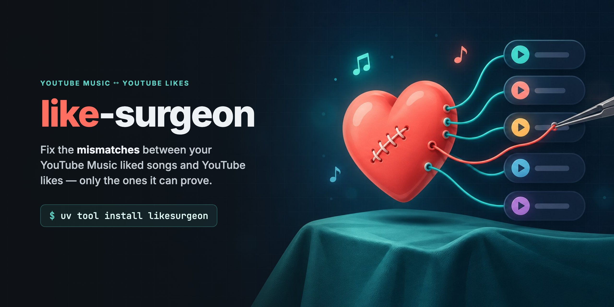
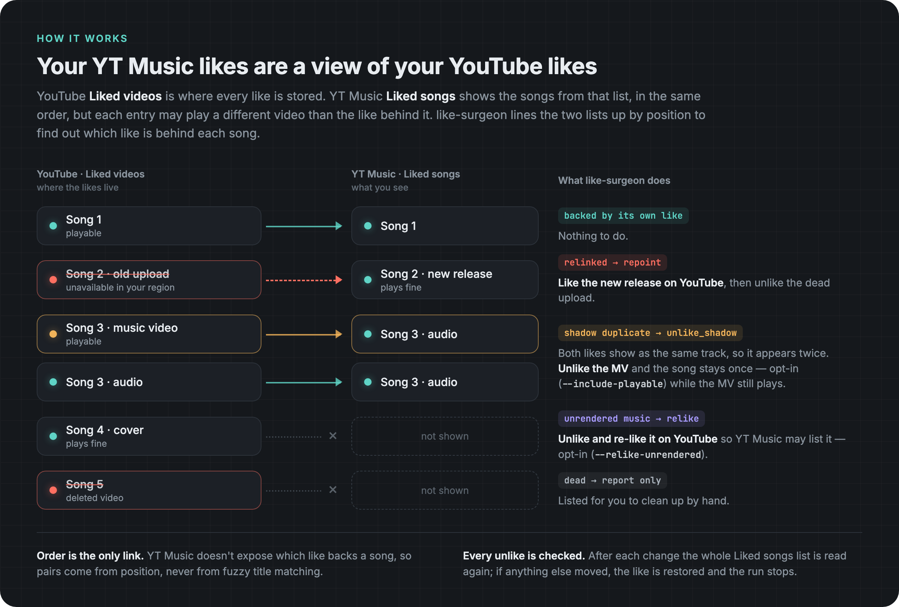
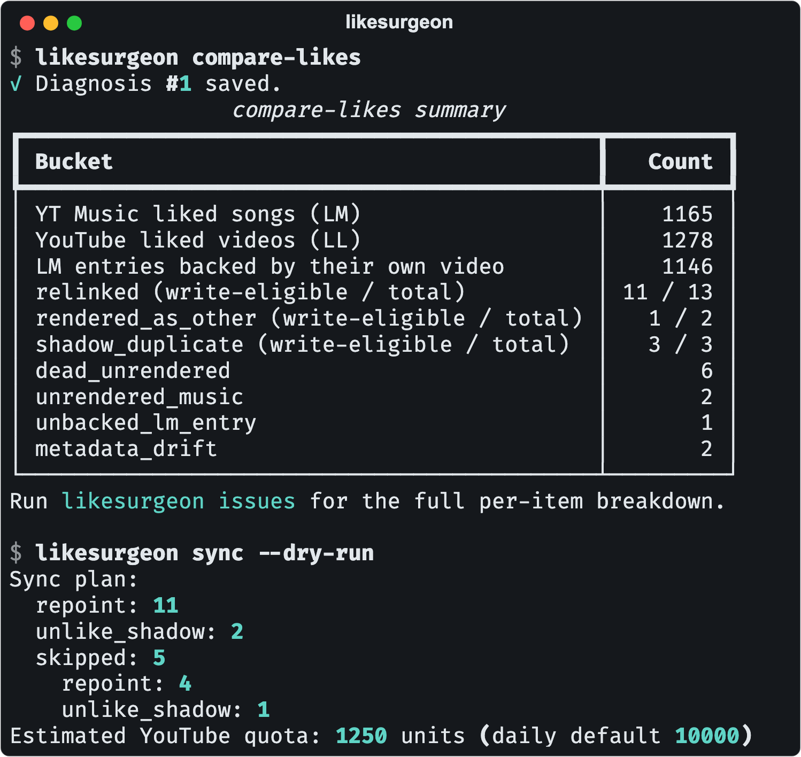

<p align="center">
  
</p>

<p align="center">
  <a href="https://pypi.org/project/likesurgeon/"></a>
  <a href="https://pypi.org/project/likesurgeon/"></a>
  <a href="https://github.com/zeikar/like-surgeon/actions/workflows/ci.yml"></a>
  <a href="https://github.com/zeikar/like-surgeon/blob/main/LICENSE"></a>
</p>

# like-surgeon

**Fix the mismatches between your YouTube Music liked songs and YouTube likes — only the ones it can prove.**

YouTube Music keeps no likes of its own: *Liked songs* is a view of your YouTube *Liked videos*, and over the years the two drift apart. A song gets swapped for another release while your like stays on the dead upload, the same song shows up twice, music you liked never appears, or a like is left on a deleted video.

like-surgeon does two things, both on YouTube with a check after every change:

- **Fix what it can prove** — `compare-likes`, then `sync`. It lines the two lists up, works out which YouTube like is behind every song, and repairs the mismatches the list order proves: a like stuck on a dead upload, a music video shown twice as its audio track (opt-in while the video still plays). Opt-in, it also re-likes music that never shows up and checks the result.
- **Tidy what you review** — `canonicalize`. Not a mismatch but a preference: the release you liked may not be the one the artist's page lists, so it doesn't show as liked there, on the album or in Top songs. It moves each like to the listed release (say, a single → the album version the artist page lists) and, when you've liked both the listed release and another one, drops the extra like. It matches the same title and length (±1 s) inside the artist's own song list, so you review its report before anything is written. On one 1,200-song library: 71 likes moved, 7 of them duplicates `compare-likes` can't see.

It's a command-line tool that runs on your machine. Each scan of both lists, and of your playlists, is kept as a snapshot in a local SQLite file, which doubles as the backup YouTube Music doesn't offer. No server, no account of ours: your data and credentials stay on your computer.

## How it works

<p align="center">
  
</p>

Liked songs keeps the order of Liked videos, filtered to what YT Music shows, and each entry may play a different video than the like behind it. YT Music never says which like backs which song, so like-surgeon lines the two lists up by position (no fuzzy title matching) and repairs the mismatches it can prove, on YouTube. The full model and the evidence for it: [docs/design/ll-lm-alignment.md](https://github.com/zeikar/like-surgeon/blob/main/docs/design/ll-lm-alignment.md). (The docs call the two lists **LL** and **LM**, after their playlist ids.)

`canonicalize` doesn't use the list order; it compares each liked song with its artist's own song list on YT Music — see [Canonicalize](https://github.com/zeikar/like-surgeon#6-canonicalize-tidy-up-releases-and-duplicates) and [docs/design/canonicalize.md](https://github.com/zeikar/like-surgeon/blob/main/docs/design/canonicalize.md).

## Quick start

Requires Python ≥ 3.11.

```bash
uv tool install likesurgeon          # or: pipx install likesurgeon
likesurgeon init
likesurgeon auth ytmusic --from-browser chrome   # reads cookies from a browser signed in to music.youtube.com
likesurgeon auth youtube                          # prints the Google Cloud setup steps; run it again to sign in
likesurgeon scan ytmusic
likesurgeon scan youtube-likes --region US        # your country code, so region-blocked videos are caught
likesurgeon compare-likes                         # what's wrong, and what can be fixed
likesurgeon sync --dry-run                        # the plan, without writing anything
likesurgeon canonicalize                          # likes on another release than the artist page lists (review, then --apply)
```

<p align="center">
  
</p>

Just want a backup? `auth ytmusic`, `scan ytmusic` and `export` are enough — no Google Cloud setup needed.

## What it finds

`compare-likes` lines up the latest scans of both lists and records one finding per mismatch. **A** is the YouTube video whose like is behind a YT Music entry, **B** is the video that entry plays.

| Finding | What happened | What `sync` does (proven pairs only) |
|---|---|---|
| `relinked` | A is unavailable, and YT Music plays B instead; B isn't liked | **repoint**: like B, then unlike A |
| `rendered_as_other` | A isn't known to be unavailable (usually a playable MV or fan upload) but YT Music shows B | repoint with `--include-playable`, if A is known to play |
| `shadow_duplicate` | A is shown as B while B is also liked, so B appears twice | **unlike A**; a playable A only with `--include-playable` |
| `dead_unrendered` | A is unavailable and not shown in YT Music at all | report only — [clean up by hand](https://github.com/zeikar/like-surgeon#dead-likes) |
| `unrendered_music` | A plays fine and looks like music, but isn't shown in YT Music | **`relike`** with `--relike-unrendered` (off by default) |
| `unbacked_lm_entry` | a YT Music entry with no like that can be pinned behind it | report only |
| `metadata_drift` | a title or artist changed between two scans | report only |

`canonicalize` keeps its own report, separate from these: `canonical_version` (a liked audio track the artist page doesn't list, with exactly one same-title, same-length track that it does) and `canonical_ambiguous` — see [Canonicalize](https://github.com/zeikar/like-surgeon#6-canonicalize-tidy-up-releases-and-duplicates).

## Safety

- **Read-only until you say so.** Only `sync`, `canonicalize --apply` and `repoint-playlists --apply` write, each after showing its plan and a y/N prompt; `sync --dry-run` writes nothing, `--limit N` ramps up, `skip <id>` keeps a finding out for good.
- **Only proven pairs.** `sync` acts on a pair only when its gap in the alignment is one-to-one and A's availability is known; repoints also need the same recording (duration within ±3 s and same channel or overlapping titles). The one exception is opt-in: `--relike-unrendered` re-likes a single video that looks like music but isn't shown in YT Music, then checks that Liked songs gained at most that one entry. `canonicalize` pairs differently — exactly one same-title audio track within ±1 s in the artist's own song list — and its Liked songs check can't tell two recordings with the same title and length apart, so review its report and `skip` anything doubtful before `--apply`.
- **Every unlike is checked.** After each change `sync` and `canonicalize --apply` confirm the rating and re-read your whole Liked songs list. If anything else moved, A is re-liked and the run stops. `repoint-playlists --apply` adds the new video to the playlist first, checks both sides, and only then deletes the dead item.
- **Writes only on YouTube.** `repoint-playlists --apply` edits playlists there too. YT Music's own like button is never pressed: it shares the same rating, and pressing it duplicates or reverts entries.
- **Local credentials.** Cookies and OAuth tokens stay in `~/.like-surgeon/`; the files the tool writes are owner-only (`0600`) on macOS and Linux.

## Usage

The commands below assume `likesurgeon` is on your `PATH`. From a source checkout, prefix them with `uv run`.

### 1. Initialize local storage

```bash
likesurgeon init
```

Creates `~/.like-surgeon/` and the SQLite database at `~/.like-surgeon/like-surgeon.sqlite`. Override with `LIKE_SURGEON_HOME=/some/path`.

### 2. Authenticate

**YouTube Music** (browser-header flow, auto-extracted from your browser):

```bash
likesurgeon auth ytmusic --from-browser chrome
```

Replace `chrome` with whichever browser you're signed into music.youtube.com on. Supported names: `chrome`, `chromium`, `firefox`, `edge`, `brave`, `safari`, `opera`, `opera_gx`, `librewolf`, `vivaldi`, `arc`, `w3m`, `lynx`. The command reads cookies from that browser's local store and writes `~/.like-surgeon/browser.json` (mode `0600`) — no DevTools copy-paste required. It also records the browser and the YT Music account signed in there (its channel handle; for an account without one, a SHA-256 hash of the Google account email together with the account name, since names alone aren't unique; the email itself is never stored) in `~/.like-surgeon/config.json` (`"ytmusic_browser"`, `"ytmusic_account"`) so stale cookies can be refreshed automatically (see Cookie staleness below). If the account can't be read (or has neither a handle nor a name and email), it warns and records no browser: refresh is off.

> **macOS.** Chrome (and Chromium-family browsers) encrypt their cookie store with a Keychain entry; the first run asks you to allow `python` (or Terminal) to access it. Firefox usually avoids the prompt because it stores cookies in plain SQLite. If extraction is still blocked, give Terminal (or your IDE) **Full Disk Access** in System Settings → Privacy & Security and retry.

If `--from-browser` doesn't work in your environment (sandboxed browser, headless server, locked DB), `likesurgeon auth ytmusic` prints the manual recipe instead: copy request headers from DevTools and paste them into `uvx --from ytmusicapi ytmusicapi browser`. Running it forgets the recorded browser and account, so a refresh can't overwrite the pasted file. If you paste headers with `ytmusicapi browser` on your own instead, run `likesurgeon auth ytmusic` once (or delete those two keys) for the same reason.

> **Treat `~/.like-surgeon/browser.json` like a session token.** It holds live YouTube Music cookies: anyone who reads it can act as you on music.youtube.com until they rotate. Don't commit it, share it, or leave it on a shared filesystem.

**YouTube Data API** (Google OAuth, desktop client):

```bash
likesurgeon auth youtube
```

The first run prints a 6-step walkthrough: create a free Google Cloud project, enable YouTube Data API v3, and download a "Desktop app" OAuth client as `~/.like-surgeon/youtube-oauth-client.json`. Run the command again and it opens your browser for consent and stores the refresh token in `~/.like-surgeon/youtube-token.json`.

### 3. Scan

**Recommended: set your region.** Region-blocked videos are only detected when like-surgeon knows your country. Create `~/.like-surgeon/config.json`:

```json
{
  "region": "US"
}
```

Use the [ISO 3166-1 alpha-2](https://en.wikipedia.org/wiki/ISO_3166-1_alpha-2) code for your country, or pass `--region <code>` to `scan youtube-likes`. Without either, each scan warns and checks only for deleted, private and rejected videos — a region-blocked video then counts as playable, so its relink shows up as `rendered_as_other` instead of `relinked`.

```bash
likesurgeon scan ytmusic          # YT Music Liked songs
likesurgeon scan youtube-likes    # YouTube Liked videos
```

Scans always fetch the full list; aligning a truncated list would be meaningless. Each scan is stored as a snapshot with the metadata of that moment, so a later rename doesn't rewrite history. After `scan youtube-likes` stores the snapshot it asks YouTube for the likes playlist's `itemCount` (1 quota unit) and warns if that is higher than the videos scanned — see [YouTube's count can be a few higher](https://github.com/zeikar/like-surgeon#caveats) below; a failed lookup only warns.

> **Cookie staleness.** YT Music cookies extracted from a browser go stale within about an hour, while the browser itself keeps fresh ones. After `auth ytmusic --from-browser`, a YT Music Liked songs or library playlists read that fails (`scan ytmusic`, `scan playlists`' library read, `canonicalize`, the checks around each `sync` / `canonicalize --apply` write) re-extracts the cookies from that browser once and retries, printing `YT Music cookies refreshed from <browser>` on stderr. The new cookies are checked in a separate file and replace `browser.json` only if the browser is still signed in to the recorded account; if it switched accounts, or the account can't be confirmed (or the run is interrupted), `browser.json` is left as it was and the read fails, so likes are never checked against another account. For an account without a channel handle the check compares the hashed Google account email and the account name (brand accounts under one Google login share the email, so two of them with the same name would still pass, though each write's full Liked songs check still applies). A renamed account without a handle, one that gains a handle, or an account recorded by an older version (0.13.0's name, or 0.13.1's name and photo URL) also counts as a different account: re-run `auth ytmusic --from-browser <browser>` to record it again. Only logged-out-looking failures (an unparseable response, a server error such as 401) trigger a refresh, not network errors; the one other trigger is an empty library list whose account menu then can't be read (for any reason), which counts as stale cookies. On macOS this can show the Keychain prompt in the middle of a run. If the refresh or the retry fails, re-run `auth ytmusic --from-browser <browser>` yourself.

### 4. Compare

```bash
likesurgeon compare-likes
likesurgeon issues
likesurgeon issues --type relinked
likesurgeon issues --min-confidence 1.0 --format json
```

`compare-likes` needs a snapshot of each source. It aligns the two lists (anchors on songs liked as themselves, then pairs the gaps between them in order), fetches `videos.list` metadata for each pair, and saves the result as a diagnosis — see [What it finds](https://github.com/zeikar/like-surgeon#what-it-finds). It warns when one of our own writes (`sync` or `canonicalize --apply`) happened after the older of the two scans (re-scan both, then re-run). Without YouTube auth, `relinked` and `rendered_as_other` pairs are report-only. `issues` lists the findings one by one.

A pair (A shown as B) is **write-eligible** only at confidence 1.0: A's availability is known and — except for `shadow_duplicate` — it passed the same-recording check (duration within ±3 s, and same channel or overlapping titles). A shadow is usually a different upload (an MV, a fan or making-of video), so `sync` proves it while acting instead: B must show at least twice before, and exactly one B must disappear after, or A is re-liked. YouTube likes in gaps whose two counts differ get no finding; the YT Music entries there are reported as `unbacked_lm_entry`.

#### Dead likes

`dead_unrendered` findings are yours to clean up by hand. A region block can lift, so unlike a blocked video only once you have liked a replacement. A **deleted** video can't be unliked through the YouTube Data API (`videos.rate` returns 404), but YT Music's rating call still removes the like — ytmusicapi `rate_song(videoId, "INDIFFERENT")`; check with `videos.getRating`, which still reads deleted videos. The video isn't shown in YT Music, so no other entry depends on it.

### 5. Sync (write actions)

`sync` applies the latest diagnosis's write-eligible findings, on YouTube only. It prints the plan and a quota estimate, warns if the diagnosis looks stale (a newer scan exists, or a scan it used is over an hour old), names any video an earlier run may have left unliked, then asks before writing.

```bash
likesurgeon sync --dry-run              # plan + quota estimate, no writes
likesurgeon sync                        # apply, with confirmation prompt
likesurgeon sync --yes                  # apply, no prompt
likesurgeon sync --limit 20 --yes       # apply the first 20 actions only
likesurgeon sync --include-playable     # also act on MV / fan-upload originals
likesurgeon sync --relike-unrendered    # also re-like music YT Music doesn't show
likesurgeon skip 812 813                # keep sync off findings #812 and #813 (unskip to undo)
```

| Action | For | Steps | Quota (`videos.rate` 50 units, `getRating` 1) |
|---|---|---|---|
| repoint | `relinked`; `rendered_as_other` with `--include-playable` | confirm A still liked and B not yet liked, like B, confirm, unlike A, confirm, full Liked songs check | 104 units |
| unlike_shadow | `shadow_duplicate` (A unavailable, or playable with `--include-playable`) | confirm B liked and shown ≥2×, confirm A still liked, unlike A, confirm, full Liked songs check | 53 units |
| relike | `unrendered_music`, with `--relike-unrendered` | confirm A liked, unlike A, confirm, like A, confirm, full Liked songs check | 103 units |

**Check and restore.** After each unlike `sync` reads the whole Liked songs list again: a repoint expects it unchanged, an unlike_shadow expects one B fewer (B still shown). On a mismatch it re-reads once after 15 s; if it still differs, A is re-liked and confirmed, because unliking a wrongly paired A would otherwise silently drop an unrelated song. A `relike` expects nothing removed and at most one entry added (one 15 s re-read if nothing was added): one added is `applied`, none is `skipped`; it never restores, and "Sync stops early when" below lists what stops the run. For a repoint, the B like it added is undone whenever A stays liked after B's like may have landed (after a restore, when the quota rejects A's unlike, or when B's like errors but landed). A restore (~51 units) and a B undo (~51 units) aren't in the plan's estimate. The default daily YouTube quota is 10,000 units; the plan warns above that, and `--limit` slices a run.

`--include-playable` is off by default: it removes a real like you made (an official MV, a fan upload) so that YT Music shows only the audio track. Keep individual findings out with `skip`.

`--relike-unrendered` is off by default too: re-liking moves a video to the top of both Liked videos and Liked songs, so it runs oldest first, which keeps the re-liked videos in their original relative order. If YT Music still doesn't show the video afterwards, the finding is `skipped` (`unskip` to retry). Whether a video counts as music is decided when `scan youtube-likes` runs, so re-scan it after upgrading before expecting `unrendered_music` to change.

#### If something goes wrong

- **Restored** — A was re-liked and the finding marked `skipped`, because A's unlike didn't take or the Liked songs check didn't match. The run stops; re-scan both sources and run `compare-likes` before syncing again. If undoing a repoint's B like fails or can't be confirmed, `sync` names the video and stops: B may still be liked, so unlike it on YouTube by hand if you don't want it (no song is lost).
- **Stale finding** — A is no longer liked (you unliked it after the scan), or B is already liked, so the finding is `skipped` without any write.
- **Stranded** — A was unliked and re-liking it failed or couldn't be confirmed, or the run was interrupted after the unlike: the song may now be liked nowhere. Stranded videos are listed on every `sync` and `canonicalize --apply` run until a later YouTube scan contains them again. Check YT Music Liked songs; if the song is missing, re-like the original on YouTube, then re-scan.
- **Aborted or quota stop** — remaining actions stay `open`. Re-scan both sources, run `compare-likes`, then `sync` again.

#### State model

- `skipped` is terminal until you run `likesurgeon unskip <id>`: a finding becomes `skipped` when B's like didn't land, a precheck failed, A was restored, a video re-liked by `relike` still isn't shown in YT Music, or you ran `skip`.
- `skipped` carries over to later diagnoses: each `compare-likes` copies it onto the matching new finding.

#### When sync refuses or stops

Sync refuses (exit 1) when:
- any write by `sync` or `canonicalize --apply` happened after the older of the two scans the diagnosis is built from — a write between scans misaligns them, and one after both makes the diagnosis stale. Re-scan both sources, then `compare-likes`.
- YouTube write scope is missing — run `likesurgeon auth youtube` again and accept "Manage your YouTube account".
- the YT Music auth probe fails (needs `browser.json`; re-run `auth ytmusic --from-browser`).

Sync stops early when:
- YT Music Liked songs can't be read (no baseline to check against),
- an action had to be restored, or a repoint's B like couldn't be confirmed undone (the diagnosis' pairs can't be trusted),
- a `relike` went wrong: Liked songs lost an entry or gained more than one, or its unlike or re-like couldn't be confirmed (A is re-liked if possible), or
- YouTube's daily quota runs out.

The run exits non-zero if any action failed or it stopped early on an unreadable Liked songs list, after a restore, after an unconfirmed B undo, or after a `relike` went wrong.

### 6. Canonicalize (tidy up releases and duplicates)

A song is often released as several identical audio tracks (a single, an album, a compilation), and the one you liked may not be the one the artist's page lists. `canonicalize` finds those likes and moves each one, on YouTube, to the listed version, so the song shows as liked on the artist page, the album and Top songs. Example: a like on the single "Kizuna Music♪" (316 s) moves to the same track on the album "Breakthrough!" (316 s, Top songs #1). If you've also liked the listed version, the extra like is removed (merge), which clears a duplicate `compare-likes` can't see. Mostly a preference, not a breakage, so it is a separate command and you review every finding first.

```bash
likesurgeon canonicalize                            # report only: reads Liked songs and each artist's songs list
likesurgeon issues --type canonical_version         # list the report again
likesurgeon skip 901 902                            # keep findings out (unskip to undo)
likesurgeon canonicalize --apply                    # move the rest, with confirmation prompt
likesurgeon canonicalize --apply --limit 5 --yes    # the 5 oldest only, no prompt
likesurgeon canonicalize --apply --include-flagged  # also findings flagged only for a version word
```

The report stores your Liked songs as a regular `scan ytmusic` snapshot, then reads each liked song's artist page one after another (minutes for a few hundred artists). A liked audio track **A** gets a finding when none of its artists' songs lists ("Show all" or Top songs) has it while exactly one audio track **B** in the "Show all" lists has the same title and length (±1 s): `canonical_version`. Two or more such tracks make a report-only `canonical_ambiguous`. A `canonical_version` is report-only as well when A's album name holds a version word (`Version`, `Ver.`, `Live`, `Remix`, `Acoustic`, `Instrumental`, `Off Vocal`, `TV Size`) or Liked songs shows A more than once. This is the only place a title picks what like-surgeon writes to: exact equality after normalization, and only inside the liked song's own artist list. (`compare-likes` also compares titles, but only to double-check pairs that the list order has already fixed.) An artist page that can't be read is a warning; its songs get no finding. That includes an artist page YT Music returned without its songs list, which it does intermittently: if the summary shows many unreadable artists, re-run later. Past 10 warnings the rest are a count. `--json` prints the report, every artist error included, as one JSON document.

`--apply` acts on the latest report as you reviewed it (open, write-eligible `canonical_version` findings), oldest first. `--include-flagged` also acts on a `canonical_version` that is report-only only because of the version word in A's album (`Best Live! collection` is a best-of album, not a live recording); the plan marks those in a Flagged column, and `skip` keeps out the ones that really are another recording. Findings Liked songs shows more than once and `canonical_ambiguous` stay report-only. B's live rating picks the action:

| Action | When | Steps | Quota |
|---|---|---|---|
| repoint | B not liked | confirm Liked songs shows A once and A is liked, like B, confirm, unlike A, confirm, full Liked songs check (one A fewer, one B more) | 104 units |
| merge | B already liked | confirm Liked songs shows A once and B at least once, and A is liked, unlike A, confirm, full Liked songs check (one A fewer) | 53 units |

**Order changes.** Liking B puts it at the top of Liked videos and Liked songs, so a repointed song moves to the top; oldest first keeps the moved songs in their relative order. A merge removes A's entry and leaves B where it is.

**What stops a run.** As in `sync`: a Liked songs check that doesn't match re-likes A. If the re-like works, the finding becomes `skipped`; otherwise A is reported stranded. The run stops either way. A B like that can't be confirmed undone, an unreadable Liked songs list and the daily quota stop it too. The run exits non-zero if any action failed or it stopped early.

**Re-scan before the next `sync`.** These are YouTube writes, so `sync` refuses a diagnosis whose older scan predates them: re-scan both sources and re-run `compare-likes` first. `canonicalize --apply` itself doesn't refuse after earlier writes; every action re-reads A, B and Liked songs live before writing.

### 7. Back up and inspect

```bash
likesurgeon snapshots
likesurgeon diff <old_snapshot_id> <new_snapshot_id>
likesurgeon export <snapshot_id> --format json --output likes.json
likesurgeon doctor
```

`snapshots` lists likes snapshots only, with a line counting the playlist snapshots it leaves out (see `likesurgeon playlists` below). `doctor` summarizes both sources: counts, the latest diagnosis, and how many YT Music songs are traced to the like behind them.

### 8. Playlists (backup and dead items)

```bash
likesurgeon scan playlists
likesurgeon playlists           # report from the latest scan
likesurgeon playlists --dead    # also list each dead item
likesurgeon export <snapshot_id> --format json --output road-trip.json
```

`scan playlists` backs up every playlist in your YT Music library, tracks and all. Liked Music is skipped (`scan ytmusic` already covers it), as are Episodes for Later and the generated Recaps; those are not backed up. It then reads the same playlists from the YouTube Data API by id and checks each video's availability, which needs `auth youtube`; region-blocked items count as dead only when `region` is set, as for likes. That side only covers playlists the API can read; the scan lists the ones it can't, and they get no dead-item data. The YT Music backup is stored before the YouTube read starts, so without YouTube auth, on a YouTube error or after Ctrl-C it is still kept. An exported playlist snapshot carries the playlist id, title and header (description and so on) next to its tracks, even when it is empty. Nothing is written to either service.

`playlists` reads the latest scan from the local database. Per playlist it shows the track count, **music share** (the part of its YT Music tracks that are audio tracks or official music videos, against user uploads and everything else) and the number of **dead** items: videos YouTube reports as deleted, private, rejected or (with a region set) region-blocked. YouTube shows a placeholder title for these, such as "Deleted video", so that is what the dead list prints instead of the original title. The first column holds each playlist's YT Music snapshot id, the one `export` takes; `diff` works on two of them as well.

#### Repoint dead playlist items

```bash
likesurgeon repoint-playlists                      # report from the latest playlist scan
likesurgeon issues --type playlist_relinked        # review the findings
likesurgeon skip <id>                              # keep any doubtful one out
likesurgeon repoint-playlists --apply --limit 1    # smallest playlist first, with confirmation
likesurgeon repoint-playlists --apply
```

A region-blocked video in one of your playlists is often shown by YT Music as another, playable video (usually the audio track), while the playlist itself still holds the blocked one. `repoint-playlists` finds these pairs from the latest scan (it needs both sides, so `auth youtube`) and saves them as `playlist_relinked` findings: A is the dead item, B the video YT Music plays in its place. A finding is write-eligible only when A and B pass the same-recording check, the playlist is yours (saved playlists are report-only) and B isn't also listed on the playlist. Deleted and private items are never paired, because YT Music doesn't show them and they can't be added back.

`--apply` plans from that report, smallest playlists first, and asks before writing. For each finding it reads both sides of the playlist and compares them with the scan (a playlist that changed since gets no writes), adds B at A's position, checks that both sides show it there, deletes A's item, and checks both sides again; YT Music must show the playlist exactly as before. If a check fails, B is removed again (or A is put back first when its delete had already gone through), the finding is marked `skipped` where YT Music's view was the problem, and the run stops. A delete that can't be confirmed stops the run with B left in place, and the run lists anything you may need to fix by hand. `--limit N` caps the findings per run, `--yes` skips the prompt. A newer playlist scan than the report makes `--apply` exit 1: re-run `scan playlists` and `repoint-playlists`. Details: [docs/design/playlist-repoint.md](https://github.com/zeikar/like-surgeon/blob/main/docs/design/playlist-repoint.md).

## Caveats

- **`ytmusicapi` is community-maintained.** YouTube Music has no official public API — if a scan fails, check the [`ytmusicapi` issue tracker](https://github.com/sigma67/ytmusicapi/issues).
- **Order alignment has limits.** YT Music exposes no backing id, so pairing relies on order. Gaps where the two counts differ stay report-only, and the YouTube API may stop at 5000 likes (unverified) — if your library is that large, compare the counts in `doctor` with what you see on YouTube.
- **YouTube's count can be a few higher than a scan's.** An old like can stay in Liked videos (the app and the playlist's `itemCount` count it) while the API reports the video as not liked and leaves it out of `playlistItems`, so scans never see it. It has been seen mostly with videos marked made for kids; they still show in the web list, with no "show unavailable videos" option. Un-liking and re-liking such a video on YouTube fixes it: the API lists it again, and YT Music may pick it up too. `scan youtube-likes` warns with the difference; [how to find them](https://github.com/zeikar/like-surgeon/blob/main/docs/notes/hidden-likes.md).
- **Google sign-in may expire weekly.** While your OAuth consent screen is in *Testing* (the setup `auth youtube` prints), Google expires its refresh tokens after 7 days; if YouTube calls start failing with an auth error, run `likesurgeon auth youtube` again.
- **`scan playlists` quota.** 1 unit per 50 items of each playlist (at least 1 per playlist tried, including the ones the Data API can't read), plus 1 unit per 50 distinct videos checked for availability. Twenty playlists of about 100 items each cost roughly 80 units.
- **`repoint-playlists --apply` quota.** About 100 units per item (an insert and a delete, 50 each) plus the playlist reads (1 unit per 50 items, a few per item); the plan prints the estimate. Undoing a failed item costs about 50 more per call and isn't estimated. YT Music reads are free.
- **YouTube Data API quota.** A scan of 5000 likes costs about 200 quota units (≈100 `playlistItems.list` + ≈100 `videos.list` calls for availability and region checks); the default daily quota is 10,000. Re-scanning a few times a day is fine.
- **Music classification is heuristic.** `unrendered_music` relies on title and channel heuristics, so edge cases will misclassify (e.g. covers labelled "tutorial"). It recognises covers, 歌ってみた (sung covers), soundtracks, remasters, remixes and similar; classification is stored at scan time, so re-scan `youtube-likes` after an upgrade. Findings are a starting point for review — `sync` acts only on write-eligible ones.

## Local layout

```
~/.like-surgeon/
├── like-surgeon.sqlite        # all snapshots, tracks, diagnoses
├── browser.json               # ytmusicapi browser-header auth
├── youtube-oauth-client.json  # your Google OAuth client (Desktop app)
├── youtube-token.json         # refresh token (created on first auth)
└── config.json                # optional settings, e.g. {"region": "US"}; auth ytmusic --from-browser adds "ytmusic_browser" and "ytmusic_account"
```

## Roadmap

Releases and the full changelog: [GitHub Releases](https://github.com/zeikar/like-surgeon/releases). Next: **1.0** — a local web UI.

## Development

```bash
git clone https://github.com/zeikar/like-surgeon.git
cd like-surgeon
uv sync --extra dev
uv run ruff check .
uv run ruff format .
uv run pytest               # unit suite; live e2e is deselected by default
uv run pytest -m live       # opt-in: needs a logged-in music.youtube.com session
```

The `live` test extracts cookies from a real browser, writes `browser.json`, and round-trips a `fetch_liked_songs` call against `music.youtube.com`. Set `LIKESURGEON_LIVE_BROWSER=firefox` (or any other supported name) to use a browser other than `chrome`.

For deeper context:
- [docs/ARCHITECTURE.md](https://github.com/zeikar/like-surgeon/blob/main/docs/ARCHITECTURE.md) — system overview, module responsibilities, DB schema, key design decisions.
- [docs/DEVELOPMENT.md](https://github.com/zeikar/like-surgeon/blob/main/docs/DEVELOPMENT.md) — test strategy, auth setup details, debugging tips, release process.

## License

MIT — see [LICENSE](https://github.com/zeikar/like-surgeon/blob/main/LICENSE).
